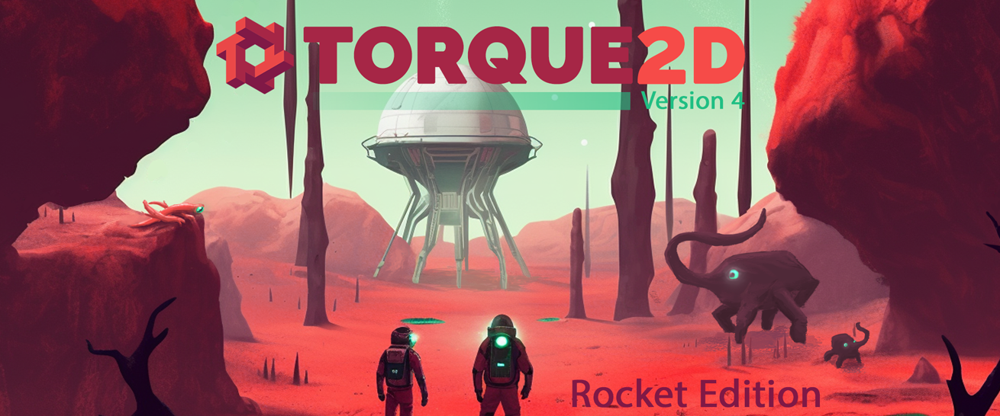

# Torque2D 4.0 (EA4 + `development`) — OpenGL 4.6 Edition

A modernized, 64-bit standalone custom engine build of **Torque2D 4.0**, based on **Early Access 4 (`master`)** merged with **31 upstream `development` commits** and upgraded with a **local OpenGL 4.6 Core Profile rendering migration**.

> **Standalone Build Notice:** This repository is maintained as a standalone OpenGL 4.6 C++17 engine build derived from Torque2D 4.0, built locally via CMake rather than distributed as official upstream precompiled binaries.

---

## Key Enhancements in This Build

### SDL 3.2.30 Upgrade & Cross-Platform Gamepad/Joystick Support

The engine’s SDL dependency has been upgraded from SDL 2.32.10 to **SDL 3.2.30** (`SDL3::SDL3-static`), powering unified cross-platform controller support across **Windows**, **macOS**, **Linux**, and **Emscripten**:

* **Shared SDL3 Gamepad & Raw Joystick Manager ([`sdlGamepad.h`](engine/source/platformSDL/sdlGamepad.h), [`sdlGamepad.cpp`](engine/source/platformSDL/sdlGamepad.cpp)):** Supports up to 8 mapped gamepads (`gamepad0`..`gamepad7`, `GamepadDeviceType`) and 8 raw joysticks (`joystick0`..`joystick7`, `JoystickDeviceType`), separating recognized controllers via `SDL_IsGamepad()` so flight sticks/HOTAS/wheels remain usable without double-firing events.
* **Event-Driven Hot-Plugging & Controller Database:** Enumerates already-connected controllers on startup (`SDL_GetGamepads` / `SDL_GetJoysticks`), handles hot-plug add/remove/remap events (`XI_CONNECT` make/break), and loads optional external `gamecontrollerdb.txt` overrides via `SDL_AddGamepadMappingsFromFile()`.
* **Cross-Platform `ActionMap`, Deadzones & Haptics:** Unlocks `ActionMap` gamepad tokens across all platforms ([`actionMap.cc`](engine/source/input/actionMap.cc)) and extends [`event.h`](engine/source/platform/event.h) with `btn_guide`, `btn_misc1`, `btn_touchpad`, and `btn_paddle1`..`btn_paddle4`. Applies 2D radial thumbstick deadzones, axial trigger deadzones, motor rumble (`SDL_RumbleGamepad`), and impulse trigger haptics (`SDL_RumbleGamepadTriggers`).
* **Unified TorqueScript API ([`platformInput_ScriptBinding.h`](engine/source/platform/platformInput_ScriptBinding.h)):** Exposes `getGamepadCount`, `isGamepadConnected`, `getGamepadName`, `getGamepadType`, `getGamepadButtonLabel`, `setGamepadRumble`, `setGamepadTriggerRumble`, `enableJoystick`, `disableJoystick`, `isJoystickDetected`, `getJoystickCount`, `getJoystickAxes`, `rumble`, and legacy XInput wrappers across platforms, backed by unit tests in [`sdlGamepadTests.cc`](engine/source/testing/tests/sdlGamepadTests.cc).

### OpenGL 4.6 Rendering Migration

The legacy fixed-function OpenGL 1.x / OpenGL ES 1.1 renderer has been migrated to a programmable **OpenGL Core Profile** (4.6 on Windows/Linux, 4.1 on macOS) and **OpenGL ES 3.x** (3.2 on Android, 3.0 on iOS/WebGL 2) pipeline. See [opengl_migration_report.txt](opengl_migration_report.txt) (and [opengl_migration_report.pdf](opengl_migration_report.pdf)) for full migration notes.

* **Custom Macro-Driven Function Loader (No GLAD/GLEW):** GL entry points are declared via internal platform macro tables ([`GLCoreFunc.h`](engine/source/platform/GLCoreFunc.h), [`GLModernFunc.h`](engine/source/platform/GLModernFunc.h) groups `GL_CORE_PROGRAMMABLE`, `GL_CORE_TEX_STORAGE`, `GL_CORE_DSA`, and [`GLModernTypes.h`](engine/source/platform/GLModernTypes.h)):
  * **Windows ([`winGL.cc`](engine/source/platformWin32/winGL.cc)):** Loads `opengl32` and `glu32` via `LoadLibrary`, resolves functions through `wglGetProcAddress` with `GetProcAddress` fallback, enumerates Core Profile extensions via `glGetStringi(GL_EXTENSIONS, ...)` when `glMajorVersion >= 3`, and records capabilities in `gGLState`.
  * **Linux ([`x86UNIXGL.cc`](engine/source/platformX86UNIX/x86UNIXGL.cc)):** Loads `libGL.so` / `libGL.so.1` through SDL 3 (`SDL_GL_LoadLibrary`) and resolves modern GL / DSA entry points via `SDL_GL_GetProcAddress`.
* **Context & Profile Architecture:**
  * **Windows ([`winOGLVideo.cc`](engine/source/platformWin32/winOGLVideo.cc)):** Creates a bootstrap WGL context, resolves `wglCreateContextAttribsARB`, and upgrades to a **Core Profile** context (`WGL_CONTEXT_CORE_PROFILE_BIT_ARB`) across versions **4.6 → 4.5 → 4.3 → 4.1 → 3.3**, setting `gGLState.isCoreProfile = true` (`OpenGLDevice::getDriverInfo()` reports `CORE_PROFILE` on GL 3.0+).
  * **Linux ([`x86UNIXOGLVideo.cc`](engine/source/platformX86UNIX/x86UNIXOGLVideo.cc)):** Uses SDL 3 (`SDL_WINDOW_OPENGL` + `SDL_GL_CreateContext`) and binds modern GL / DSA functions in `GL_EXT_Init()`, using `SDL_GL_SetSwapInterval` for vsync/swap control.
  * **macOS ([`platformGL.h`](engine/source/platformOSX/platformGL.h), [`osxGL.mm`](engine/source/platformOSX/osxGL.mm), [`osxOpenGLDevice.mm`](engine/source/platformOSX/osxOpenGLDevice.mm), [`osxOutlineGL.cc`](engine/source/platformOSX/osxOutlineGL.cc)):** Switched from legacy `<OpenGL/gl.h>` to `<OpenGL/gl3.h>` and `<OpenGL/gl3ext.h>`, requests **OpenGL 4.1 Core Profile** (`NSOpenGLProfileVersion4_1Core` / `kCGLOGLPVersion_GL4_Core`, falling back to 3.2 Core), queries version and `GL_CONTEXT_PROFILE_MASK`, enumerates GL 3+ extensions with `glGetStringi(GL_EXTENSIONS, i)`, reports `CORE_PROFILE` in `getDriverInfo()`, uses `glPolygonMode` in `TORQUE_DEBUG` wireframe rendering, and disables `suppDSA` / `suppTexStorage` (`GLDSA` enables `glGenVertexArrays`/`glDeleteVertexArrays` on `TORQUE_OS_OSX`).
  * **iOS ([`platformGL.h`](engine/source/platformiOS/platformGL.h), [`iOSGL.mm`](engine/source/platformiOS/iOSGL.mm), [`iOSGL2ES.mm`](engine/source/platformiOS/iOSGL2ES.mm), [`T2DViewController.mm`](engine/source/platformiOS/T2DViewController.mm)):** Migrated from ES 1.1 (`<OpenGLES/ES1/gl.h>`, `kEAGLRenderingAPIOpenGLES1`, `*_OES` framebuffer calls) to **OpenGL ES 3.0** (`<OpenGLES/ES3/gl.h>`, `kEAGLRenderingAPIOpenGLES3`), enabling ES 3.0 VAOs and `glTexStorage2D` in `GLDSA`, enumerating extensions via `glGetStringi`, defining `GL_RED`/`GL_GREEN`/`GL_BLUE`/`GL_ALPHA` guards in `GLModernTypes.h`, and emitting `#version 300 es`.
  * **Android & Web Targets:** Targets **OpenGL ES 3.2** (`#version 320 es` with `highp` precision qualifiers, linking `GLESv3` via [`AndroidGL2ES.h`](engine/source/platformAndroid/AndroidGL2ES.h)), and configures Emscripten builds with `-sUSE_SDL=3` (or optional `-DTORQUE_EMSCRIPTEN_VENDORED_SDL3=ON`), `-sMIN_WEBGL_VERSION=2`, and `-sMAX_WEBGL_VERSION=2` (`#version 300 es`).
* **Programmable Shader & Streaming Batch Pipeline ([`ShaderManager.h`](engine/source/graphics/ShaderManager.h), [`ShaderManager.cc`](engine/source/graphics/ShaderManager.cc)):** Replaces fixed-function state with a built-in GLSL uber-shader (`#version 460 core` on Windows/Linux GL 4.6, `#version 410 core` on macOS 4.1 Core, `#version 320 es` on Android ES 3.2, `#version 300 es` on iOS ES 3.0 / WebGL 2) exposing `uMVP`, `uModelView`, `uTexture0`, `uTexMode` (`DGLTexMode`: none, modulate, blend, replace, add), `uTexEnvColor`, `uAlphaThreshold`, and 4 eye-space clip planes (`uClipPlaneCount`, `uClipPlanes[4]`). Renders interleaved `DGLVertex` geometry (position, texCoord, color) through persistent dynamic VAO/VBO/IBO objects (`sDynamicVAO`, `sDynamicVBO`, `sDynamicIBO`) with `GL_STREAM_DRAW` buffer orphaning, wireframe line expansion, and triangle conversion helpers for `GL_QUADS`, `GL_QUAD_STRIP`, and `GL_POLYGON`.
* **Direct State Access ([`glDSA.h`](engine/source/graphics/glDSA.h), [`glDSA.cc`](engine/source/graphics/glDSA.cc)):** `GLDSA` dispatches to OpenGL 4.5+ DSA functions (`glCreateBuffers`, `glNamedBufferData`, `glNamedBufferSubData`, `glCreateVertexArrays`, `glCreateTextures`, `glTextureStorage2D`, `glTextureSubImage2D`, `glTextureParameteri`, `glTextureParameteriv`, `glBindTextureUnit`) when `gGLState.suppDSA` is active on Windows (`TORQUE_OS_WIN`) and Linux (`TORQUE_OS_LINUX`), falling back seamlessly to bind-based calls on ES 3.x (Android/iOS/Web), macOS (VAO creation/deletion enabled; `textureStorage2D` omitted since Apple stops at GL 4.1), and pre-4.5 drivers.
* **CPU Matrix Stacks & Core Textures ([`dglMatrix.cc`](engine/source/graphics/dglMatrix.cc), [`TextureManager.cc`](engine/source/graphics/TextureManager.cc), [`TextureHandle.cc`](engine/source/graphics/TextureHandle.cc)):** Replaces deprecated GL matrix stacks with 32-deep CPU `MODELVIEW`/`PROJECTION`/`TEXTURE` stacks (`uMVP`/`uModelView`, `dglPointToScreen`), glyph batching (`flushGlyphBatch`), Core/ES sized internal texture formats (`GL_R8`, `GL_RG8`, `GL_RGB8`, `GL_RGBA8`, `GL_RGB565`, `GL_RGB5_A1`, `GL_RGBA4`), `GL_TEXTURE_SWIZZLE_R/G/B/A`, and `GL_CLAMP_TO_EDGE` across migrated 2D and GUI rendering paths.
* **Migration Unit Tests ([`openglMigrationTests.cc`](engine/source/testing/tests/openglMigrationTests.cc)):** Includes 7 GoogleTest unit tests covering GLSL `#version` preprocessing (`460 core`, `320 es`, invalid args), CPU render-state accessors, CPU matrix stacks and MVP math, and Core/ES sized format, swizzle, and channel constants.

### Upstream `development` Integration (31 Commits on 4.0 EA4)

Merged 31 upstream `development` commits onto the Torque2D 4.0 Early Access 4 (`master`) foundation:

* **SDL Backend (Upgraded to SDL 3.2.30):** Upgraded vendored SDL support (`platformSDL`) from SDL 2.32.10 to static **SDL 3.2.30** (`SDL3::SDL3-static`), alongside Linux tiling-WM, fullscreen, scroll-wheel, and UTF-8 text input fixes.
* **GUI & Font Fixes:** Added `textRotation` support, tooltip profile fixes, focus/first-responder fixes, `GuiScrollCtrl` / `textWrap` / `textExtend` sizing fixes, and theme font rebaking.
* **Platform & Test Fixes:** Integrated the Windows [`winFileio.cc`](engine/source/platformWin32/winFileio.cc) case-sensitive `StringTable` scan fix as well as particle unit tests (`particleAssetFieldTests.cc`, `particleEmissionAngleTests.cc`).

### 64-Bit Desktop & Linux Platform Support

* **Windows (x64):** Built as C++17 with MSVC static runtime (`/MT`), `/Zc:wchar_t-`, and `_HAS_STD_BYTE=0`, linking static controller-only **SDL 3.2.30** (`SDL3::SDL3-static`, `TORQUE_SDL_GAMEPAD`) alongside native Win32 windowing. On 64-bit builds (`CMAKE_SIZEOF_VOID_P == 8`), `POST_BUILD` automatically stages `engine/lib/openal/win64/OpenAL32.dll` alongside the executable at the repository root.
* **macOS:** Built alongside native Cocoa windowing (`osxTorqueView.mm`) and controller-only **SDL 3.2.30** (`SDL3::SDL3-static`, `TORQUE_SDL_GAMEPAD`).
* **Linux (x86_64):** Automatically defines `LINUX`, `TORQUE_SDL`, `TORQUE_SDL_GAMEPAD`, and `TORQUE_64` on 64-bit targets, linking vendored static **SDL 3.2.30** (`SDL3::SDL3-static`) with `Threads::Threads`, `OpenGL::GL`, `Freetype::Freetype`, `X11`, `Xft`, `fontconfig`, `openal`, `m`, `dl`, and `rt`.

---

## Building from Source (CMake)

[**CMakeLists.txt**](CMakeLists.txt) is the single source of truth for configuring and building the engine (`Debug`, `Release`, and `Shipping` configurations, C++17). The legacy hand-maintained project files under `engine/compilers/` have been retired.

### Quick Release Build (Out-of-Source)

Configure and build the **Release** binary out-of-source from the repository root:

```bash
cmake -B build -DCMAKE_BUILD_TYPE=Release
cmake --build build --config Release --parallel
```

> **Generator Notes:**
> * Single-config generators (Ninja, Unix Makefiles on Linux) use `-DCMAKE_BUILD_TYPE=Release` during configure.
> * Multi-config generators (Visual Studio on Windows) select the build type via `--config Release` at build time (add `-A x64` if your Visual Studio generator requires an explicit 64-bit architecture flag).
> * **Output Location:** Desktop binaries are written directly to the repository root (`Torque2D.exe` / `Torque2D_DEBUG.exe` with `OpenAL32.dll` on Windows; `Torque2D` / `Torque2D_DEBUG` on Linux) alongside `main.cs`.

### CMake Targets

* **`Torque2D` (Primary Target):** Engine executable on Windows, Linux, macOS, iOS, and Emscripten; `libtorque2d.so` `SHARED` library on Android ([`cmake/EngineSources.cmake`](cmake/EngineSources.cmake), [`cmake/PlatformSources.cmake`](cmake/PlatformSources.cmake)).
* **Bundled Static Libraries ([`engine/lib/CMakeLists.txt`](engine/lib/CMakeLists.txt)):** `SDL3::SDL3-static` (Windows, macOS, Linux, and optional Emscripten vendored fallback), `zlib` (non-Android), `libogg`, `libvorbis`, `lpng`, `ljpeg`, and `gtest` (desktop builds).

### Platform Convenience Scripts

Convenience wrappers live at the repository root (see [`cmake/BUILD-PLATFORM-NOTES.md`](cmake/BUILD-PLATFORM-NOTES.md) for full platform prerequisites):

* **Windows (Visual Studio 2022 / 2026):** [`generate-vs2022.bat`](generate-vs2022.bat) or [`generate-vs2026.bat`](generate-vs2026.bat) generates `build\vs2022\` or `build\vs2026\` with `Torque2D.sln` ready to run from the repo root.
* **Linux:** [`build-linux.sh`](build-linux.sh) (full configure + build) or [`generate-make.sh`](generate-make.sh) (Makefile generation).
* **macOS / iOS:** [`generate-xcode.command`](generate-xcode.command), [`generate-xcode-ios.command`](generate-xcode-ios.command), [`generate-xcode-ios-device.command`](generate-xcode-ios-device.command).
* **WebAssembly (Emscripten):** [`generate-emscripten.sh`](generate-emscripten.sh) (via `emcmake`).

### Running the Tests

After building `Torque2D_DEBUG.exe` (or `Torque2D.exe` for `-Release`) at the repository root, run the automated suites using PowerShell 7 (`pwsh`) on Windows (or [`tests/run.sh`](tests/run.sh) on Unix):

* **C++ unit tests (GoogleTest, Debug):** `pwsh -ExecutionPolicy Bypass -File tests\run-unit.ps1`
* **C++ unit tests (GoogleTest, Release):** `pwsh -ExecutionPolicy Bypass -File tests\run-unit.ps1 -Release`
* **TorqueScript integration / smoke tests (Debug):** `pwsh -ExecutionPolicy Bypass -File tests\run.ps1` (`-Shots` for screenshot harnesses)

Logs are written under `tests\logs\`.

---

## Torque2D 4.0 Overview & Features

Dedicated to 2D game development, **Torque2D** is a flexible C++ engine combining OpenGL Core Profile / OpenGL ES 3.x batched 2D rendering, Box2D physics, OpenAL audio, skeletal and spritesheet animation, automated asset management, a modular project structure, TAML object persistence, and TorqueScript ([`TORQUE_SCRIPT.md`](TORQUE_SCRIPT.md)).

### Editors & GUI System (4.0 Early Access 4)

Torque2D 4.0 (*Rocket Edition*) integrates interactive in-engine editors directly inside the console/tool bar (`Tilde (~) + Ctrl` or the console button in the Toybox):

* **Asset Manager & Project Manager:** Create, edit, and organize images, animations, particle effects, bitmap fonts, audio assets, and reusable game modules without hand-editing XML files.
* **GUI Editor:** Drag-and-drop or click-to-place controls onto the canvas, align/space controls via the Layout menu, undo/redo, and cut/copy/paste across GUIs.
* **Explorer & Context-Aware Properties Pane:** Inspect the control tree with hide/lock columns and drag-to-reparent, paired with purpose-built property editors (anchor picker, color swatches, visual image picker, list-box row and menu-bar item editors) tailored to each control class.
* **Classic `.gui` & TAML Persistence:** Save GUIs either as classic `.gui` scripts or TAML with unsaved-change protection.
* **Theme & Gui Profile Editor:** Author reusable control themes (profiles, borders, fonts, colors) with live preview and re-skin entire GUIs via Set Theme. See the upstream [Gui Guide](https://github.com/TorqueGameEngines/Torque2D/wiki/GUI-Guide) for usage details.

### Batteries Included (Toybox)

When you first run Torque2D, you can create a new project or open the **Toybox**, a collection of over 30 sample "toys" (modules) demonstrating Torque2D features—starting from the default monster truck side-scrolling demo. Click **Show Tools** in the lower-right corner to browse toys, and inspect each toy's scripts and assets under the `toybox/` directory as practical examples.

### Documentation & Community

* [Torque2D GitHub Wiki](https://github.com/TorqueGameEngines/Torque2D/wiki) — tutorials, architecture notes, script reference, and guides
* [Changelog](CHANGELOG.md) — release and engine history
* [Torque 2D Forums on Torque Game Engines](https://torque3d.org/forums/forum/26-general/)
* [Torque Game Engines on Discord](https://discord.com/invite/qdAZxT4)

*(Note: The original GarageGames website is offline; the links above are the active upstream community hubs.)*

---

## Credits & Upstream Attribution

* **Upstream Engine:** Built upon **Torque2D** created by **GarageGames, LLC** and maintained by **TorqueGameEngines** and the open-source community ([TorqueGameEngines/Torque2D](https://github.com/TorqueGameEngines/Torque2D)).
* **This Build:** Maintained independently as a standalone 64-bit custom **OpenGL 4.6** engine build incorporating Torque2D 4.0 EA4 (`master`), 31 upstream `development` commits, and local OpenGL 4.6 migration upgrades under the original **MIT License** ([`LICENSE.md`](LICENSE.md)).

## License

Copyright (c) 2012 GarageGames, LLC

Permission is hereby granted, free of charge, to any person obtaining a copy
of this software and associated documentation files (the "Software"), to
deal in the Software without restriction, including without limitation the
rights to use, copy, modify, merge, publish, distribute, sublicense, and/or
sell copies of the Software, and to permit persons to whom the Software is
furnished to do so, subject to the following conditions:

The above copyright notice and this permission notice shall be included in
all copies or substantial portions of the Software.

THE SOFTWARE IS PROVIDED "AS IS", WITHOUT WARRANTY OF ANY KIND, EXPRESS OR
IMPLIED, INCLUDING BUT NOT LIMITED TO THE WARRANTIES OF MERCHANTABILITY,
FITNESS FOR A PARTICULAR PURPOSE AND NONINFRINGEMENT. IN NO EVENT SHALL THE
AUTHORS OR COPYRIGHT HOLDERS BE LIABLE FOR ANY CLAIM, DAMAGES OR OTHER
LIABILITY, WHETHER IN AN ACTION OF CONTRACT, TORT OR OTHERWISE, ARISING
FROM, OUT OF OR IN CONNECTION WITH THE SOFTWARE OR THE USE OR OTHER DEALINGS
IN THE SOFTWARE.
